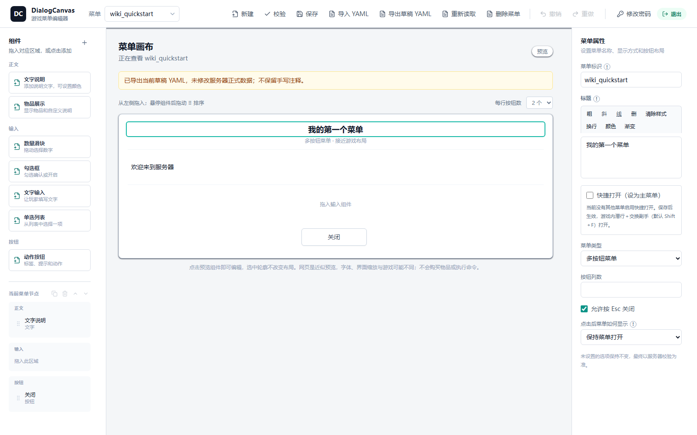

# 01.3 十分钟创建第一个菜单

[返回 Wiki 首页](../README.md) · [项目入口](../../../README.md)

**前置知识：** 安装并登录；游戏玩家有 dcmenu.admin 或 dcmenu.command.open。

## 路线 A：从网页空白菜单开始

1. 顶部点击“新建”。右侧菜单属性把“菜单标识”改成 `wiki_first`，离开输入框提交。若已有同名菜单，另选 `wiki_first_2`，不覆盖。
2. 在右侧“标题”框输入“我的第一个菜单”，离开文字框；标题立即在中央预览变化。此时只是本页编辑，未保存。
3. “菜单类型”保留“多按钮菜单”对应 `multi_action`。新建草稿自带关闭按钮；不要删到零个按钮。
4. 左侧点“文字说明”添加正文；选中新正文，右侧文字填“欢迎来到服务器”，离开输入框。也可把左侧组件拖入中央正文区域。
5. 选中已有关闭按钮，在“显示文字”中填“知道了”，“按钮点击方式”保留“关闭菜单”。
6. 点“校验”。有错误时按定位修正；点“保存”，等待“保存全部完成”。仅看到预览变化或“已应用”不算保存。
7. 控制台 `dcmenu list` 应列出 `wiki_first`。游戏执行 `/dcmenu open wiki_first`，或控制台 `dcmenu open wiki_first 完整在线玩家名`。
8. 游戏看到标题和正文，按钮关闭。客户端显示需自己确认；浏览器的像素位置不保证一致。

下图为本轮隔离 Paper + 打包页面实际截图，版本 0.1.0（2026-10-16）。验证实例使用 `wiki_quickstart`，标题和正文对应上面的填写值，关闭按钮仍是默认文字；不是游戏客户端截图。



## 路线 B：导入一份最小提示菜单

顶部“导入 YAML”选择 [wiki_01_notice.yml](../../../examples/wiki/menus/wiki_01_notice.yml)，核对 ID/标题/校验后“确认进入草稿”，再“保存”。游戏 `/dcmenu open wiki_01_notice`。浏览器无需把文件复制到服务器目录。

也可使用以下完整文件。它与示例文件逐字一致；走手动目录路线时保存为 `menus/wiki_01_notice.yml`，执行 `dcmenu reload wiki_01_notice`。

```yaml
# ===== DCMenu 完整中文注释教学原件 =====
# 首次启动生成于 plugins/DialogCanvas/examples/menus/，不会自动加载或执行交易。
# 按需在网页“导入 YAML”→核对预览→确认草稿→校验→保存；或复制到插件根 menus 后 dcmenu reload。
# 导航示例先安装01、02再安装03；勿覆盖已有同名菜单，勿手改正式 JSON 或同步基线。
# 网页保存会规范化正式 YAML 并丢弃手写注释；本教学原件不会被保存操作覆盖。
# 附近的注释解释同一行各字段；注释不属于配置，不会进入 JSON 或发送给客户端。
# 教程 01：最小提示菜单，无外部依赖，不发物品、不执行命令。
# 安装时只复制本 YAML 到插件根目录 menus，文件名必须是 wiki_01_notice.yml。
# 控制台执行 dcmenu reload wiki_01_notice；成功后在游戏执行 /dcmenu open wiki_01_notice。
# 若有同名菜单，先换一个合法 ID 和相同文件名，不要覆盖现有文件。
# schemaVersion：菜单文档格式版本，当前填整数 1；不是插件版本，也不是 API 的 revision。
schemaVersion: 1 # 当前唯一支持的菜单结构版本，不是 revision。
# id：菜单根 id 要与文件名一致，只用小写字母、数字、下划线或连字符；按钮 id 在本菜单内唯一，建议沿用这些字符。
id: wiki_01_notice # 1～64 位小写字母、数字、下划线或连字符。
# title：菜单顶部标题；字符串支持 & 颜色码。带 &、#、冒号等特殊字符的文字要加引号。
title: '&6你好，DCMenu' # 字符串简写使用 & 颜色码，必须加引号。
# dialogType：菜单类型：notice 为提示，confirmation 为确认/取消，multi_action 为多按钮。修改时须使用对应按钮槽位。
dialogType: notice # 提示菜单只有一个确认按钮；下面显式配置它。
# canCloseWithEscape：是否允许按 Esc 关闭，true 允许、false 不允许；关闭不等于完成业务确认。
canCloseWithEscape: true # 允许 Esc 关闭；不代表业务确认。
# afterAction：点击后的原生行为：CLOSE 关闭，NONE 保持，WAIT_FOR_RESPONSE 等待服务器响应；业务动作另在 actions 配置。
afterAction: CLOSE # 点击按钮后关闭，不会暂停服务器。
# body：正文列表，按顺序展示 text 文字或 item 物品；展示物品不会发到背包。
body:
  # type：本段具体类型；正文、输入、条件和动作各有不同类型，不可互换。紧邻示例值决定本段用途。
  - type: text # 一个正文文本块。
    # text：文字内容；消息动作可用 $(amount) 或 $(16 * $(amount)) 等模板，amount 必须为已有输入 key。
    text: '这是我的第一个菜单。' # 普通中文同样可用字符串简写。
    # width：原生控件/内容宽度参数，单位为界面像素；不是屏幕横坐标，合法范围以网页元数据和校验结果为准。
    width: 300 # 原生布局宽度，单位为界面像素参数，不是屏幕坐标。
# noticeAction：notice 提示菜单的唯一按钮配置；不是 multi_action 的按钮列表。
noticeAction:
  # id：菜单根 id 要与文件名一致，只用小写字母、数字、下划线或连字符；按钮 id 在本菜单内唯一，建议沿用这些字符。
  id: close # 按钮 ID 在本菜单中唯一。
  # label：通常为控件或按钮显示文字，和 id/key 不同；若位于 player_data_set.value 自定义对象内，则只是普通业务数据。
  label: '知道了' # 显示文字与按钮 ID 不同。
  # actionType：原生按钮点击类型；custom 交给业务引擎处理条件/动作，close 只关闭。不要与动作链的 type 混淆。
  actionType: close # 只关闭，不执行条件或业务动作。
```

## 如何确认结果

“重新读取”后标题和正文仍在，说明不是仅内存草稿；正式 JSON、对应 YAML 及同步状态由插件更新。若显示部分成功，不重复保存，先核查同步。`reload` 只导入 YAML，不刷新所有插件设置。

## 相关章节

[网页组件](../02-editor/components.md) · [YAML 教程](../03-yaml/tutorial.md)

---

[上一章：01.2 安装、目录与登录](installation.md) · [下一章：02.1 菜单管理与保存](../02-editor/management.md)

[返回 Wiki 首页](../README.md) 
